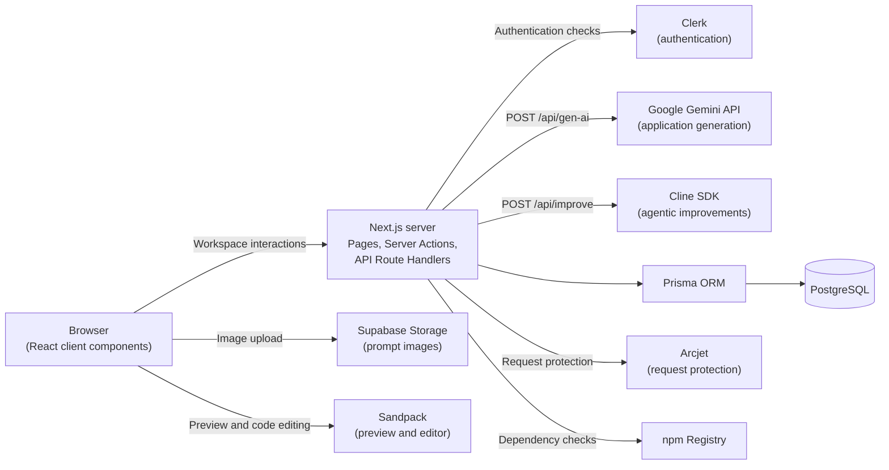
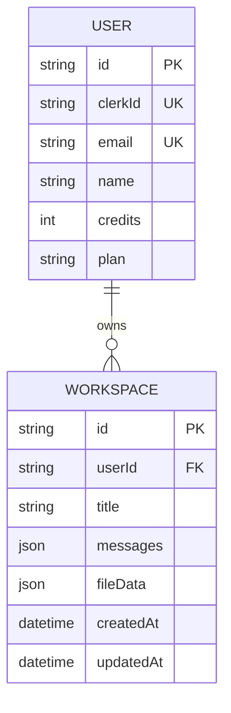

<div align="center">

# Forge — Agentic AI App Builder

</div>

<div align="center">

[](https://nextjs.org/)
[](https://react.dev/)
[](https://www.typescriptlang.org/)
[](https://tailwindcss.com/)
[](https://clerk.com/)
[](https://supabase.com/)
[](https://www.prisma.io/)
[](https://ai.google.dev/)
[](https://sandpack.codesandbox.io/)
[](https://arcjet.com/)

</div>

Forge is an AI-powered agentic app builder that turns natural-language prompts into React applications. It generates project files and dependencies, renders the result in an interactive browser preview, and lets users refine the code through a conversational interface.

The application uses the Next.js App Router for its pages and server functionality. Google Gemini powers initial code generation, the Cline SDK provides the agent used for code improvements, Sandpack runs the generated application preview, and Prisma stores users and workspaces in PostgreSQL. Clerk manages authentication and plan entitlements, Supabase Storage handles prompt-image uploads, and Arcjet adds request protection.

## Problem Statement

Starting a front-end project involves translating requirements into components, choosing dependencies, writing and organizing files, configuring a preview environment, and repeatedly fixing errors as the application develops.

Forge brings these steps into one browser-based workflow. Users describe an application in natural language, receive a generated React project, inspect and edit its files, and see changes in a live preview. A chat-based improvement flow can update existing files, while project history keeps generated workspaces available for later sessions.

The application also includes image-aware prompts, downloadable project exports, account-based workspaces, and credit-based usage plans. The goal is to make prototyping and iterative front-end development accessible without requiring users to create a local project before they can see a working result.

## Key Features

### 🤖 AI Application Generation

- **Prompt-to-React Generation** — Google Gemini `gemini-3.8-flash` generates a project response containing an application title, an assistant summary, a file map, and a dependency map. Generated application files use JavaScript and React rather than TypeScript.
- **Streamed Generation Updates** — The `/api/gen-ai` Route Handler streams progress and completion events to the workspace interface using Server-Sent Events (SSE).
- **Dependency Validation** — Proposed packages are checked against the npm registry before they are included in the saved project data. Packages that cannot be validated are omitted from the dependency map.
- **Image-Aware Prompts** — Users can attach an image to a prompt. The image is uploaded to the configured Supabase Storage bucket and its public URL is included as context for generation.
- **Retry and Error States** — The generation route retries eligible interrupted or temporarily unavailable Gemini requests and returns structured error information for quota, interruption, and service-availability failures.

### 🪄 Agentic Code Improvement

- **Cline-Based Improvement Agent** — The `/api/improve` route creates a Cline `Agent` using Gemini and gives it focused tools for updating files and reporting completion.
- **Complete-File Updates** — The `update_file` tool receives a file path and its complete replacement contents, rather than applying an unstructured text patch.
- **Streamed Improvement Events** — The route sends thinking updates, file-patch events, completion data, and error events to the workspace client.
- **Persisted Conversation and Project State** — The improvement workflow saves the updated file data and chat messages with the workspace so the conversation can be continued when the project is reopened.
- **Plan-Gated Access** — Improve with AI is restricted to the Pro plan by the server-side plan check.

### 👁️ Live Preview and Code Editing

- **Sandpack Preview** — Generated React files are rendered in an embedded Sandpack environment, with Tailwind CSS loaded as an external resource.
- **File Explorer and Code Editor** — Users can browse generated files, select a file, and edit its contents in the built-in editor.
- **Live File Synchronization** — File changes are passed into Sandpack so the preview reflects the current project files.
- **Preview Error Recovery** — When the preview reports an error, the interface offers an action that sends the error context back through the generation flow for a corrective update.
- **ZIP Export** — The editor assembles the generated source, a package manifest, and a basic React entry point into a downloadable ZIP using JSZip.

### 💬 Workspace and Project Management

- **Persistent Workspaces** — Each workspace stores its title, conversation messages, generated file data, and timestamps in PostgreSQL.
- **Project History** — The Projects page lists the signed-in user's workspaces, ordered by their most recently updated time.
- **Conversation Context** — Previous user and assistant messages are retained with the workspace and can be supplied as context during subsequent generation requests.
- **Project Deletion** — Users can delete a workspace from the project list; the delete operation is scoped to the authenticated user's database record.

### 🔐 Authentication, Plans, and Credits

- **Clerk Authentication** — Clerk provides sign-in, sign-up, session identity, and the user menu. The protected route-group layout requires an authenticated session.
- **Clerk Billing Plans** — The interface includes Free, Starter, and Pro plan options and uses Clerk's `CheckoutButton` for paid-plan checkout.
- **Credit Tracking** — The Prisma `User` record stores the current credit balance and plan. The configured plan allocations are 10 credits for Free, 50 for Starter, and 100 for Pro; a generation or improvement operation costs one credit.
- **User-Scoped Data** — Server-side project queries use the authenticated Clerk identity to find the corresponding database user and scope workspace reads and deletes.

### 🛡️ Request Protection

- **Arcjet Shield and Bot Detection** — `proxy.ts` applies Arcjet Shield and bot-detection rules through the Next.js proxy/middleware integration.
- **Generation Rate Limiting** — The generation route uses an Arcjet token bucket configured for a capacity of five requests and a refill rate of five requests per 60 seconds.
- **Prompt-Injection and Sensitive-Information Checks** — The generation protection rules enable prompt-injection detection and deny configured sensitive information categories, including credit-card numbers, API keys, and AWS secret keys.

## Real-World Use Cases

- **🧱 Prototype a front-end idea:** Describe an application in plain language and generate a React project without first creating a local development environment.
- **🖼️ Recreate a visual reference:** Attach a screenshot or mockup and include it as context for the generated interface.
- **🔎 Inspect generated source:** Browse the file tree and review or edit the generated JavaScript files.
- **⚡ Iterate on an application:** Ask the improvement agent to change a component, layout, or interaction while keeping the existing project context.
- **🐛 Fix a preview issue:** Send a Sandpack preview error back through the generation flow for an AI-assisted correction.
- **📦 Export a project:** Download the generated files and a basic React project scaffold as a ZIP archive.
- **🗂️ Continue previous work:** Reopen a saved workspace and continue from its stored messages and project files.

## Tech Stack

| Technology        | Purpose                                                                           |
| ----------------- | --------------------------------------------------------------------------------- |
| ⚡ `Next.js`      | Routing, server components, Server Actions, one Route Handler                     |
| ⚛️ `React`        | Client-side workspace, chat, editor, and interface components                     |
| 🔵 `TypeScript`   | Types for application code, workspace messages, project data, and API integration |
| 🎨 `Tailwind CSS` | Utility-first styling and responsive interface layout                             |
| 🧩 `shadcn/ui`    | UI component setup and styling conventions                                        |
| 🔐 `Clerk`        | Authentication, user sessions, route protection, and billing plan checkout        |
| 🗄️ `Supabase`     | Upload and public URL retrieval for user-supplied prompt images                   |
| 🔷 `Prisma ORM`   | Database schema, queries, transactions, and migrations                            |
| 🤖 `Gemini`       | Gemini requests for interview questions and transcript-based feedback             |
| 🧰 `Cline SDK`    | Agent execution and tool-driven file updates in the improvement workflow          |
| 🧪 `Sandpack`     | In-browser React preview, file explorer, and code editor                          |
| 🛡️ `Arcjet`       | Shield, bot detection, and booking/withdrawal rate limiting                       |
| 📦 `JSZip`        | Client-side ZIP creation for generated project exports                            |
| 🎯 `Lucide React` | Interface icons                                                                   |
| 🔔 `Sonner`       | Toast notifications                                                               |
| ☁️ `Vercel`       | Deployment                                                                        |

## System Architecture and Data Flow

Forge uses the Next.js App Router. Client components manage the workspace interface, conversation, file editing, and preview. API Route Handlers communicate with Gemini and the Cline agent, while Prisma manages persistent application data.



### Application generation flow

1. A signed-in user enters a prompt in the workspace chat and can optionally attach an image.
2. The image, when present, is uploaded to the `workspace-images` Supabase Storage bucket. The client sends the resulting image URL with the user message.
3. The client sends the current workspace identifier, message history, and current project file data to `POST /api/gen-ai`.
4. The route resolves the user through Clerk, applies Arcjet protection, checks the user's credit balance, and builds Gemini conversation contents from the messages and current project context.
5. Gemini streams its response. The route collects the JSON response, checks for the required `/App.js` entry file, and validates proposed package names against the npm registry.
6. The route saves the workspace's messages and file data through Prisma, decrements the generation credit, and emits a `done` SSE event containing the workspace ID, assistant message, final file data, and remaining credits.
7. The client updates the workspace state and renders the generated files through Sandpack.

### Code improvement flow

1. The user submits an improvement request from the workspace editor.
2. The client sends the workspace ID and improvement request to `POST /api/improve`.
3. The server authenticates the request, checks the user's plan and credits, verifies workspace ownership, and loads the current project state from the database.
4. A Cline agent receives the project files as context. Its `update_file` tool emits complete file contents as `file_patch` events; the `done_improving` tool supplies the final summary.
5. After a successful run, the route saves the updated files and conversation messages and updates the credit balance.
6. The client applies the final project data and completion summary to the workspace UI.

### Workspace and project history flow

1. The protected workspace page obtains the authenticated user and, when an `id` query parameter is supplied, loads the matching workspace scoped to that user.
2. A new generation creates a workspace; subsequent generation and improvement operations update the existing workspace.
3. The Projects page queries workspaces for the current database user and orders them by `updatedAt` descending.
4. Deletion uses a Server Action that scopes the delete operation by both workspace ID and the current user's database ID.

`proxy.ts` runs Clerk middleware together with Arcjet Shield and bot detection. The protected route-group layout separately calls `auth.protect()` before rendering its child pages.

## Folder Structure

```text
agentic-app-builder/
├── actions/
│   ├── projects.ts                    # List and delete the signed-in user's projects
│   └── workspace.ts                   # Load workspace user and workspace data
├── app/
│   ├── (auth)/
│   │   ├── sign-in/                   # Clerk sign-in page
│   │   └── sign-up/                   # Clerk sign-up page
│   ├── (protected)/
│   │   ├── projects/page.tsx          # User's saved projects
│   │   ├── workspace/page.tsx         # Workspace page and initial data loading
│   │   └── layout.tsx                 # Protected route-group layout
│   ├── api/
│   │   ├── gen-ai/route.ts            # Gemini application generation endpoint
│   │   └── improve/route.ts           # Cline-based code improvement endpoint
│   ├── globals.css
│   ├── layout.tsx                     # Root layout, providers, metadata, and header
│   └── page.tsx                       # Public landing page
├── components/
│   ├── animate-ui/                    # Animated background component
│   ├── ui/                            # Reusable UI primitives
│   ├── ChatPanel.tsx                  # Prompt chat and image upload interface
│   ├── CodePanel.tsx                  # Sandpack preview, file editor, and ZIP export
│   ├── WorkspaceClient.tsx            # Workspace state and AI request orchestration
│   ├── ProjectCard.tsx                # Saved project list
│   ├── DeleteProjectModal.tsx         # Project deletion confirmation
│   ├── PricingModal.tsx               # Free, Starter, and Pro plan interface
│   ├── Header.tsx                     # Main navigation and account controls
│   ├── EmptyState.tsx                 # Empty projects state
│   ├── Reusables.tsx                  # Shared typography and section components
│   └── theme-provider.tsx             # Theme provider
├── lib/
│   ├── generated/prisma/              # Generated Prisma Client output (not committed)
│   ├── arcjet.ts                      # Generation-request Arcjet rules
│   ├── clerk-theme.ts                 # Clerk component appearance
│   ├── constants.ts                   # Credit costs and plan definitions
│   ├── data.ts                        # Landing-page content and suggestions
│   ├── getUser.ts                     # Clerk-to-database user synchronization
│   ├── prisma.ts                      # Prisma Client and PostgreSQL adapter
│   ├── supabase.ts                    # Supabase Storage client
│   └── utils.ts                       # Shared utility export
├── prisma/
│   ├── migrations/                    # Committed PostgreSQL migration history
│   └── schema.prisma                  # User and Workspace models
├── types/
│   ├── plans.ts                       # Plan type
│   ├── project.ts                     # Project summary type
│   └── workspace.ts                   # Message, file, and workspace types
├── public/                            # Forge and assistant logo assets
├── proxy.ts                           # Clerk middleware and Arcjet request checks
├── prisma.config.ts                   # Prisma schema, migration, and DIRECT_URL config
├── next.config.ts                     # Server external packages and image hosts
├── components.json                    # UI component configuration
├── eslint.config.mjs
├── postcss.config.mjs
├── tsconfig.json
├── package.json
├── package-lock.json
├── vercel.json
├── AGENTS.md
└── .gitignore
```

## Database Schema

Forge uses PostgreSQL with Prisma ORM. The schema defines two relational models in `prisma/schema.prisma`: `User` and `Workspace`. Conversation messages and generated project files are stored as JSON fields so the application can persist the evolving workspace without creating a separate database row for every message or file.

#### **`User`**

| Field        | Type          | Description                                      |
| :----------- | :------------ | :----------------------------------------------- |
| `id`         | `String`      | Primary key generated with `cuid()`              |
| `clerkId`    | `String`      | Required, unique Clerk user identifier           |
| `name`       | `String`      | User display name                                |
| `email`      | `String`      | Required, unique email address                   |
| `imageUrl`   | `String`      | Profile image URL; defaults to an empty string   |
| `credits`    | `Int`         | Credit balance; defaults to `10`                 |
| `plan`       | `String`      | Plan key; defaults to `free`                     |
| `createdAt`  | `DateTime`    | Creation timestamp; defaults to the current time |
| `updatedAt`  | `DateTime`    | Updated automatically by Prisma                  |
| `workspaces` | `Workspace[]` | One-to-many relation to the user's workspaces    |

#### **`Workspace`**

| Field       | Type       | Description                                                   |
| :---------- | :--------- | :------------------------------------------------------------ |
| `id`        | `String`   | Primary key generated with `cuid()`                           |
| `title`     | `String?`  | Optional generated project title                              |
| `userId`    | `String`   | Required foreign key referencing `User.id`                    |
| `user`      | `User`     | Parent user relation; cascades on user deletion               |
| `messages`  | `Json`     | Conversation history; defaults to an empty JSON array         |
| `fileData`  | `Json?`    | Nullable JSON value containing title, files, and dependencies |
| `createdAt` | `DateTime` | Creation timestamp; defaults to the current time              |
| `updatedAt` | `DateTime` | Updated automatically by Prisma                               |

A saved `fileData` value follows the application's `FileData` type: an optional project title, a `files` object whose entries contain source code, and a `dependencies` object mapping package names to version strings. A message contains a `role` (`user` or `assistant`), text content, and an optional image URL.

### Entity relationship overview

The following diagram represents the two Prisma models and their one-to-many relationship. Messages and generated file entries are embedded in the `Workspace` JSON fields; they are not separate relational models.



### Constraints, indexes, and migrations

The Prisma schema and committed initial migration define the following constraints:

- `User.id` and `Workspace.id` are primary keys.
- `User.clerkId` and `User.email` have unique indexes.
- `Workspace.userId` references `User.id` with `ON DELETE CASCADE` and has a database index.
- `Workspace.messages` is non-null JSONB and defaults to `[]`.
- `Workspace.fileData` is nullable JSONB.
- `createdAt` fields default to the current timestamp; Prisma manages `updatedAt` values.

## API Reference

The application defines two Next.js Route Handlers. Both use Server-Sent Events (SSE) after the initial request checks succeed. The routes resolve identity from Clerk rather than treating a client-supplied user identifier as the authentication source.

#### `POST /api/gen-ai`

Generates a new React application or updates an existing workspace using Google Gemini. The route expects a signed-in user with an existing database user record and sufficient credits.

**Request body**

| Property      | Type               | Description                                                                            |
| ------------- | ------------------ | -------------------------------------------------------------------------------------- |
| `workspaceId` | `string \| null`   | Existing workspace ID to update, or `null` to create a workspace                       |
| `messages`    | `Message[]`        | Conversation history; each message has a `role`, `content`, and optional `imageUrl`    |
| `fileData`    | `FileData \| null` | Current generated project data supplied as context when continuing an existing project |

A representative request body:

```json
{
  "workspaceId": null,
  "messages": [
    {
      "role": "user",
      "content": "Build a task manager with priority labels and a weekly view."
    }
  ],
  "fileData": null
}
```

**Example**

```bash
curl -X POST http://localhost:3000/api/gen-ai \
  -H "Content-Type: application/json" \
  -d '{
    "workspaceId": null,
    "messages": [
      {
        "role": "user",
        "content": "Build a task manager with priority labels and a weekly view."
      }
    ],
    "fileData": null
  }'
```

**Streaming events and behavior**

The successful response uses `Content-Type: text/event-stream`. Each event is sent as a `data: { ... }` frame followed by a blank line.

| Event    | Main fields                                                       | Purpose                                                             |
| -------- | ----------------------------------------------------------------- | ------------------------------------------------------------------- |
| `status` | `message`                                                         | Progress updates such as generation, package validation, and saving |
| `done`   | `workspaceId`, `assistantMessage`, `fileData`, `creditsRemaining` | Final project data and updated credit balance                       |
| `error`  | `message`, `errorType`, `status`, optional `retryAfter`           | A generation or processing failure                                  |

**Authentication and behavior**

- Clerk authentication is required. The route resolves the current Clerk user and finds the corresponding Prisma `User` record.
- Arcjet applies request limits and prompt/sensitive-information checks before the Gemini request.
- The route accepts an existing workspace ID to update, or creates a new workspace when the ID is `null`.
- Gemini is configured with the `gemini-3.8-flash` model and requests JSON output containing `assistantMessage`, `title`, `files`, and `dependencies`.
- The generated project must include `/App.js`; a response without that entry file is rejected.
- The route checks proposed dependencies against the npm registry before storing them.
- Generation uses one credit. The route persists the conversation and project data and decrements the user's credit balance when saving succeeds.
- Eligible interrupted or temporarily unavailable Gemini requests are retried, up to three attempts.

**HTTP errors returned before streaming**

| Status | Response `error`                          | Condition                                                     |
| ------ | ----------------------------------------- | ------------------------------------------------------------- |
| `400`  | `No messages provided`                    | The request does not contain messages                         |
| `401`  | `Unauthorized`                            | No authenticated Clerk user is available                      |
| `402`  | `Insufficient credits`                    | The database user does not have the required credit balance   |
| `404`  | `User not found`                          | The authenticated Clerk ID has no corresponding database user |
| `429`  | Arcjet denial reason or `Request blocked` | The generation request is blocked by Arcjet                   |

Errors that occur after the stream starts are sent as SSE `error` events rather than as a new HTTP response status.

#### `POST /api/improve`

Improves an existing React project using a Cline agent backed by Google Gemini. The updated client contract sends the workspace identifier and the user's improvement request; the route loads the current project state from the database.

**Request body**

| Property      | Type     | Description                                                                         |
| ------------- | -------- | ----------------------------------------------------------------------------------- |
| `workspaceId` | `string` | Workspace to improve; the server verifies that it belongs to the authenticated user |
| `userRequest` | `string` | Natural-language description of the requested changes                               |

A representative request body:

```json
{
  "workspaceId": "your-workspace-id",
  "userRequest": "Make the sidebar collapsible and improve the mobile layout."
}
```

**Example**

```bash
curl -X POST http://localhost:3000/api/improve \
  -H "Content-Type: application/json" \
  -d '{
    "workspaceId": "your-workspace-id",
    "userRequest": "Make the sidebar collapsible and improve the mobile layout."
  }'
```

**Streaming events and behavior**

| Event        | Main fields                               | Purpose                                                                |
| ------------ | ----------------------------------------- | ---------------------------------------------------------------------- |
| `status`     | `message`                                 | Initial agent status                                                   |
| `thinking`   | `text`                                    | Streamed assistant progress text                                       |
| `file_patch` | `path`, `code`, `reason`                  | Complete replacement contents for a file and the reason for the change |
| `done`       | `fileData`, `summary`, `creditsRemaining` | Final project state, completion summary, and remaining credits         |
| `error`      | `message`                                 | Agent or persistence failure                                           |

**Authentication and behavior**

- Clerk authentication is required, and the route resolves the database user from the authenticated Clerk ID.
- The route checks the Pro plan and available credits before starting the improvement stream.
- The workspace is loaded and checked against the authenticated database user; project files are not accepted as authoritative client input.
- The Cline agent uses the `gemini-3.8-flash` model and exposes `update_file` and `done_improving` tools.
- File updates are emitted as `file_patch` events while the agent runs. The client applies the final `fileData` from the `done` event.
- On successful completion, the route persists the updated files and both sides of the improvement conversation and decrements one credit.
- The route uses the Node.js runtime and declares a maximum duration of 300 seconds.

**HTTP errors returned before streaming**

| Status | Condition                                                              |
| ------ | ---------------------------------------------------------------------- |
| `401`  | No authenticated Clerk user is available                               |
| `402`  | The user does not have enough credits                                  |
| `403`  | The user's plan does not allow Improve with AI                         |
| `404`  | The database user or requested workspace cannot be found for that user |
| `503`  | The AI service is unavailable before the stream starts                 |

Errors raised after streaming begins are sent as SSE `error` events.

## External Integrations

### 1. Google Gemini

**Purpose:** Generate complete React applications and provide the model used by the code-improvement agent.

**Implementation:** `app/api/gen-ai/route.ts` and `app/api/improve/route.ts`.

The generation route uses the `@google/genai` SDK and the `gemini-3.8-flash` model with JSON response output. The improvement route uses the Cline SDK with Gemini as the configured provider and the same model identifier.

### 2. Cline SDK

**Purpose:** Run a tool-using agent that applies requested changes to existing project files.

**Implementation:** `app/api/improve/route.ts`.

The route registers an `update_file` tool for complete file replacements and a `done_improving` tool for the final summary. Tool progress and file changes are forwarded to the browser through SSE events.

### 3. Clerk

**Purpose:** User authentication, session identity, plan entitlement checks, and paid-plan checkout.

**Implementation:** `app/layout.tsx`, `app/(auth)/`, `app/(protected)/layout.tsx`, `proxy.ts`, `lib/getUser.ts`, `components/Header.tsx`, and `components/PricingModal.tsx`.

The application uses Clerk's provider and UI components for sign-in, sign-up, and account management. `getUser()` synchronizes the authenticated Clerk profile and plan with the local Prisma user record. The pricing interface uses Clerk's `CheckoutButton` with the plan identifiers configured in `lib/constants.ts`.

### 4. PostgreSQL and Prisma

**Purpose:** Persist user accounts, credit balances, plans, workspaces, conversation messages, and generated project data.

**Implementation:** `prisma/schema.prisma`, `prisma.config.ts`, `lib/prisma.ts`, `actions/projects.ts`, and `actions/workspace.ts`.

Prisma uses the PostgreSQL driver adapter from `@prisma/adapter-pg`. The runtime client reads `DATABASE_URL`; the Prisma CLI configuration reads `DIRECT_URL` for migration operations. Committed SQL migrations are stored in `prisma/migrations/`.

### 5. Supabase Storage

**Purpose:** Store image attachments submitted with generation prompts.

**Implementation:** `lib/supabase.ts` and `components/ChatPanel.tsx`.

The client uploads images to the `workspace-images` bucket and obtains a public URL for use in the message sent to the generation route. The Supabase project must have this bucket configured with storage policies appropriate for the application's upload and public-read behavior.

### 6. Arcjet

**Purpose:** Protect incoming requests against suspicious traffic, automated bots, excessive generation requests, prompt injection, and selected sensitive-information categories.

**Implementation:** `proxy.ts` and `lib/arcjet.ts`.

The proxy-level Arcjet client applies Shield and bot detection. The generation route uses the additional token-bucket, prompt-injection, and sensitive-information rules configured in `lib/arcjet.ts`.

**Configuration note:** The current source uses `ARCJET_KEY` in `proxy.ts` but the misspelled `ARCJEY_KEY` in `lib/arcjet.ts`. Until those source references are made consistent, configure both variables with the same Arcjet key.

### 7. Sandpack

**Purpose:** Run and edit generated React applications inside the browser.

**Implementation:** `components/CodePanel.tsx`.

Sandpack provides the preview, file explorer, and code editor. Tailwind CSS is loaded in the preview from `https://cdn.tailwindcss.com`. The preview is an in-browser development environment for the generated application; it is separate from deploying the user's exported project.

## Environment Variables

#### Example `.env`

```bash
# Clerk authentication
NEXT_PUBLIC_CLERK_PUBLISHABLE_KEY=your-clerk-publishable-key
CLERK_SECRET_KEY=your-clerk-secret-key

# PostgreSQL
DATABASE_URL=your-postgresql-runtime-connection-string
DIRECT_URL=your-postgresql-direct-connection-string

# Google Gemini
GEMINI_API_KEY=your-google-gemini-api-key

# Supabase Storage
NEXT_PUBLIC_SUPABASE_URL=https://your-project.supabase.co
NEXT_PUBLIC_SUPABASE_ANON_KEY=your-supabase-anon-key

# Arcjet
ARCJET_KEY=your-arcjet-key
ARCJEY_KEY=your-arcjet-key
```

### Local configuration notes

- `DATABASE_URL` is used by the runtime Prisma PostgreSQL adapter. `DIRECT_URL` is read by `prisma.config.ts` for Prisma CLI migration operations. Use connection strings for the same PostgreSQL database, with the connection mode appropriate to each use.
- The Clerk publishable and secret keys must belong to the same Clerk application. Configure the `starter` and `pro` plan identifiers referenced in `lib/constants.ts` in Clerk Billing; the server checks the plan keys `starter` and `pro`.
- `GEMINI_API_KEY` is read by both the generation and improvement routes.
- Create a Supabase Storage bucket named `workspace-images`. The Supabase URL and anon key are public client configuration; configure bucket and storage policies deliberately rather than exposing a service-role key in the browser.
- The current source reads both `ARCJET_KEY` and `ARCJEY_KEY` (the latter is a spelling inconsistency in `lib/arcjet.ts`). Use the same Arcjet key for both until the source is aligned.
- The repository's `.gitignore` excludes `.env*` files. Keep actual credentials out of version control and restart the development server after changing environment values.

## Prerequisites

- **Node.js 20.9 or later:** Required by the installed Next.js 16 major version. See the [Next.js installation requirements](https://nextjs.org/docs/app/getting-started/installation).
- **npm:** Used to install dependencies; `package-lock.json` is included in the repository.
- **PostgreSQL database:** Required for user, credit, plan, and workspace persistence. Provide both runtime and direct connection URLs.
- **Clerk application:** Required for sign-in, sign-up, protected workspaces, and plan checkout. Configure the `starter` and `pro` billing plans used by the application.
- **Google Gemini API key:** Required for application generation and agentic improvements.
- **Supabase project:** Required for prompt-image uploads. Create the `workspace-images` Storage bucket and configure its access policies.
- **Arcjet account and key:** Required by the request-protection configuration in `proxy.ts` and `lib/arcjet.ts`.

## Installation and Local Setup

1. **Clone or extract the repository**

   ```bash
   git clone https://github.com/jyothikaogeti/forge-agentic-app-builder.git
   cd forge-agentic-app-builder
   ```

2. **Install dependencies**

   ```bash
   npm install
   ```

3. **Configure environment variables**

   Create a root-level `.env` file and add the Clerk, PostgreSQL, Gemini, Supabase, and Arcjet values described above. Use development credentials and a non-production database while setting up the application.

4. **Prepare the PostgreSQL database**

   Confirm that both database connection strings point to the intended PostgreSQL database. Apply the committed migration and generate the Prisma Client:

   ```bash
   npx prisma generate
   npx prisma migrate deploy
   ```

   `prisma.config.ts` supplies the schema and migration paths and reads `DIRECT_URL`. The generated client is written to `lib/generated/prisma/`, which is excluded from version control.

5. **Configure Clerk**

   Create or select a Clerk application and add its publishable and secret keys. Configure the plan keys `starter` and `pro` and use the corresponding plan IDs already defined in `lib/constants.ts` for the checkout interface.

6. **Configure Supabase Storage**

   Create the `workspace-images` bucket in the Supabase project. Configure storage permissions so signed-in users can upload their prompt images and the application can retrieve the public URLs it uses in generation messages.

7. **Start the development server**

   ```bash
   npm run dev
   ```

   Open [http://localhost:3000](http://localhost:3000) in your browser.

8. **Verify locally**
   - Confirm that the landing page and Clerk sign-in/sign-up flows load.
   - Sign in and confirm that the application resolves a database user and displays the credit balance.
   - Generate a small React application and verify that the workspace and conversation are saved.
   - Open the saved project from the Projects page and confirm that the files and messages load.
   - Test the Sandpack preview, code editor, preview-error recovery action, and ZIP export.
   - Upload an image with a prompt and verify that it is stored in the `workspace-images` bucket.
   - Test Improve with AI using a Pro account and confirm that file changes, conversation history, and remaining credits are updated.

## Available Scripts

The `package.json` defines the following npm scripts.

| Command         | Purpose                                                          |
| :-------------- | :--------------------------------------------------------------- |
| `npm run dev`   | Starts the Next.js development server.                           |
| `npm run build` | Builds the application for production.                           |
| `npm run start` | Starts the built application with the Next.js production server. |
| `npm run lint`  | Runs ESLint using the repository configuration.                  |

The repository does not currently define dedicated npm scripts for tests, Prisma migrations, or Prisma Client generation. Use the Prisma CLI commands shown in the setup section when working with the database.

## Deployment

- Build the application with `npm run build` and run it with `npm run start` in a Node.js environment compatible with Next.js 16.
- Configure all production environment variables in the hosting platform. Keep the Clerk secret key, Gemini key, database URLs, and Arcjet key values server-side.
- Apply committed database migrations as part of the deployment process:

  ```bash
  npx prisma generate
  npx prisma migrate deploy
  ```

- Confirm the runtime `DATABASE_URL` and migration `DIRECT_URL` point to the intended production PostgreSQL database.
- Configure the production Clerk application, including the `starter` and `pro` plan keys and their billing plan IDs.
- Configure the Supabase production project and the `workspace-images` bucket with the required storage permissions.
- Confirm that both Arcjet key variable names are configured while the source-level spelling mismatch remains.
- The AI Route Handlers use the Node.js runtime and declare `maxDuration = 300`. Choose a hosting environment and function settings that support the application's streaming responses and required execution duration.
- The repository includes a `vercel.json` with the `fluid` deployment option enabled.
- Before opening the application to users, test authentication, a full generation, an improvement request, saved workspace retrieval, image upload, ZIP export, and the configured credit/plan checks in the deployed environment.

## Troubleshooting

| Symptom                                                       | Likely Cause / Solution                                                                                                                                                                                                     |
| :------------------------------------------------------------ | :-------------------------------------------------------------------------------------------------------------------------------------------------------------------------------------------------------------------------- |
| **The application cannot connect to PostgreSQL**              | Check `DATABASE_URL` for runtime access and `DIRECT_URL` for Prisma CLI operations. Confirm that the database is reachable and that both URLs target the intended database.                                                 |
| **Prisma reports that its generated client cannot be found**  | Run `npx prisma generate` from the repository root. The configured generated output under `lib/generated/prisma/` is ignored by Git and must exist in the local/build environment.                                          |
| **Prisma migrations are not applied**                         | Confirm `DIRECT_URL` is set, then run `npx prisma migrate status` and `npx prisma migrate deploy`. Review the migration history before applying changes to a production database.                                           |
| **Clerk sign-in or plan detection fails**                     | Check the publishable and secret keys, confirm they belong to the same Clerk application, and ensure the configured plan keys are `starter` and `pro`. Restart the development server after changing environment variables. |
| **A user is authenticated but has no database record**        | The application synchronizes Clerk users through `getUser()`. Check server logs and database connectivity for errors during user lookup or creation.                                                                        |
| **Gemini generation fails**                                   | Verify `GEMINI_API_KEY`, confirm model access, and inspect server logs for quota, service availability, interrupted-stream, or invalid-response errors.                                                                     |
| **Generation requests are rejected with `429`**               | Arcjet may have blocked the request because of the token-bucket limit, prompt-injection detection, or another configured rule. Review Arcjet events and the request logs.                                                   |
| **Improve with AI returns `403`**                             | The improvement route requires the Pro plan. Confirm the signed-in Clerk plan and the synchronized `User.plan` value.                                                                                                       |
| **Improve with AI cannot access project files**               | Confirm the workspace belongs to the signed-in user and has saved `fileData`. The improvement route loads the project from the database.                                                                                    |
| **Arcjet fails to initialize in one part of the application** | `proxy.ts` currently reads `ARCJET_KEY`, while `lib/arcjet.ts` reads `ARCJEY_KEY`. Set both to the same valid key or make the source variable names consistent.                                                             |
| **Prompt image upload fails**                                 | Verify `NEXT_PUBLIC_SUPABASE_URL`, `NEXT_PUBLIC_SUPABASE_ANON_KEY`, the `workspace-images` bucket name, and the bucket's upload/public URL policies.                                                                        |
| **A generated package is missing from the preview**           | The generation route filters proposed packages through the npm registry. Check that the package exists, that the registry is reachable, and that Sandpack can resolve the package and version.                              |
| **The preview displays a runtime error**                      | Inspect the error shown by Sandpack, use the preview error recovery action, and review the generated file contents and dependency map if the issue persists.                                                                |
| **ZIP export does not complete**                              | Confirm a project has generated files and check the browser console for errors during JSZip generation or the download action.                                                                                              |

## Learning Outcomes

- **AI-Assisted Code Generation** — Converts natural-language requirements into a structured React project using Gemini's generated JSON response.
- **Agentic Tool Use** — Uses the Cline SDK and schema-defined tools to make complete, targeted file updates.
- **Streaming Interfaces** — Sends generation progress, improvement updates, and completion events to a client through Server-Sent Events.
- **Live Development Environments** — Integrates Sandpack to preview and edit generated React code directly in the browser.
- **Full-Stack Next.js Architecture** — Organizes pages, protected route groups, Server Actions, and API Route Handlers in the App Router.
- **Authentication and Entitlements** — Uses Clerk identity and plan checks to control access to workspace features and paid functionality.
- **Relational Data Modeling** — Stores users and workspaces in PostgreSQL with Prisma relations, indexes, migrations, and JSONB project data.
- **Usage and Credit Management** — Tracks credits and plan allocations in the application's database and connects paid plans through Clerk Billing.
- **File Storage Integration** — Uploads prompt images to Supabase Storage and passes their URLs into the generation workflow.
- **Application Security** — Applies Arcjet request shielding, bot detection, rate limiting, prompt-injection detection, and sensitive-information checks.
